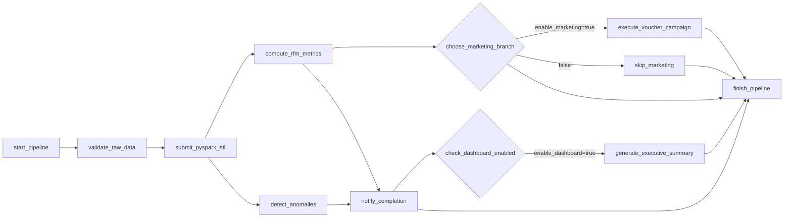

# DAG ecommerce_etl_dag_allinone

Phiên bản gộp pipeline daily và hai consumer vào **một DAG gồm 12 task**.
Lịch chạy là cron ngày, không sử dụng Asset-aware scheduling, không khai báo
inlets/outlets và không phát Asset event. Các DAG cũ được giữ để đối chiếu.



- RFM và Anomaly giữ nguyên Spark job, kiểm tra chất lượng, publication marker
  và cơ chế tái sử dụng snapshot khi retry. Chỉ bỏ việc phát Asset.
- Marketing dùng manifest RFM của đúng DagRun, chạy sau RFM mà không chờ Audit.
- Notify chờ cả hai nhánh, đối soát snapshot và ghi completion. Metadata nhỏ
  được chuyển bằng XCom; Parquet vẫn nằm trên filesystem, không đưa vào XCom.
- Dashboard đọc XCom của notify trong cùng DagRun, kiểm tra hash, marker,
  model và các output `_SUCCESS`. Không đọc con trỏ ngày mới nhất.
- `choose_marketing_branch` dùng `BranchPythonOperator`: tham số
  `enable_marketing` chọn Marketing hoặc `skip_marketing`; nhánh còn lại bị skip.
- `check_dashboard_enabled` dùng `ShortCircuitOperator`: khi `enable_dashboard`
  là false, chỉ Dashboard bị skip. `ignore_downstream_trigger_rules=False`
  cho phép task nối cuối tự xét trigger rule; không nối gate trực tiếp tới task cuối.
- Leaf duy nhất `finish_pipeline` dùng `none_failed_min_one_success`, các task
  khác dùng `all_success`. Bỏ qua consumer có chủ đích vẫn cho phép hoàn tất;
  lỗi pipeline/consumer vẫn chặn thành công. Notify là upstream trực tiếp của
  task cuối nên vẫn bắt buộc ngay cả khi tắt cả hai consumer.
- Marketing/Dashboard vẫn là demo ghi log, chưa gửi voucher/email hoặc cập
  nhật dashboard bên ngoài.

Giữ lịch `0 0 * * *` UTC với khoảng lịch sử 2010–2011, `catchup=False`, mặc
định paused, một active run, cùng pool `retail_spark` một slot và driver 3g.
Nhánh độc lập trong graph không có nghĩa hai Spark JVM chạy song song.
OpenLineage và Spark listener tùy chọn tiếp tục hoạt động; lineage metadata
không phải Asset scheduling.

Chuẩn bị landing, pool và model như [SETUP.md](SETUP.md). Chạy thủ công DAG
`ecommerce_etl_dag_allinone` với `{"business_date":"2011-12-09"}`; có thể ghim
`model_version`. Training vẫn độc lập theo tháng vì không dùng Asset schedule
và daily cần model đã huấn luyện với cutoff hợp lệ trước ngày scoring.

Hai tham số boolean `enable_marketing` và `enable_dashboard` mặc định `true`.
Ví dụ chỉ chạy Dashboard sau pipeline:

```json
{"business_date":"2011-12-09","enable_marketing":false,"enable_dashboard":true}
```

Đặt cả hai thành `false` để chỉ chạy pipeline và publication. Đây là điều kiện
theo cấu hình của lần chạy, chưa phải điều kiện tự động theo số khách hàng hay
số bất thường. Task `skip_marketing` thành công là đường đi thay thế; task
`execute_voucher_campaign` mới là task có trạng thái `skipped` khi tắt Marketing.

Khi demo, chọn một trong daily cũ và all-in-one để tránh xử lý trùng cùng
ngày. Output theo run được tách bằng DAG ID/run ID; con trỏ published theo
ngày vẫn dùng chung. All-in-one không kích hoạt hai consumer DAG cũ.

Kiểm chứng: `tests/test_allinone_dag.py` kiểm tra graph, không có outlets,
serialization, Marketing chạy khi thiếu Audit, Dashboard chờ completion,
retry, lỗi Spark, loại snapshot khác run, lineage, bốn tổ hợp tham số và phạm vi
skip thực tế của ShortCircuitOperator. Chưa chạy toàn dataset
hoặc gửi bất kỳ chiến dịch Marketing thực tế nào bằng DAG mới.
