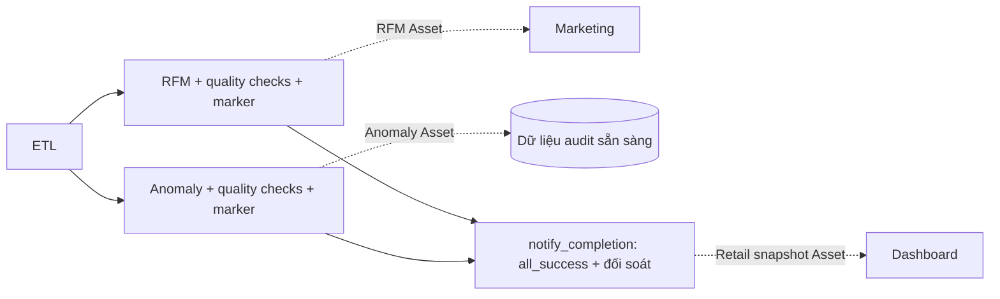

# Asset scheduling: hai nhánh độc lập, Dashboard dùng snapshot tổng hợp

Cập nhật 12/10/2026. Daily giữ nguyên 6 task, các cạnh phụ thuộc, lịch và pool.
Không thêm DAG hoặc dịch vụ ghép event.

| Task công bố | Asset | Nơi sử dụng |
|---|---|---|
| compute_rfm_metrics | RFM_CUSTOMERS_ASSET | Marketing |
| detect_anomalies | FLAGGED_ANOMALIES_ASSET | Consumer audit có thể bổ sung sau; hiện chưa có DAG riêng |
| notify_completion | RETAIL_SNAPSHOT_ASSET; giữ CURATED_TRANSACTIONS_ASSET | Dashboard chỉ nghe snapshot tổng hợp |



## Công bố từng nhánh

Hai operator RfmSparkSubmitOperator và AuditSparkSubmitOperator dùng chung
BranchSparkSubmitOperator. Trong execute: chạy Spark → kiểm tra manifest →
ghi publication marker atomic → gắn outlet metadata → task success mới phát
Asset. Lỗi Spark/kiểm tra/ghi marker khiến task fail, không phát Asset sẵn sàng.
Không dùng success callback để thực hiện kiểm tra bắt buộc.

Spark tiếp tục chịu trách nhiệm kiểm tra chất lượng dữ liệu, schema, RFM và
đối soát số bản ghi audit. Gate điều phối chỉ đọc JSON và kiểm tra _SUCCESS:
context của run, hash ETL đã dùng, model ghim cho RFM, và đầy đủ các output.
RFM yêu cầu customers/cluster_profile; Audit yêu cầu row_assessments,
order_assessments/flagged_orders. Không đọc manifest của nhánh còn lại.

Các marker theo run:

- manifests/runs/<run_key>/rfm_publication.json
- manifests/runs/<run_key>/audit_publication.json

Mỗi marker chứa context và bản sao ETL/nhánh tương ứng. Retry/clear task dùng
lại snapshot đã công bố nếu các kiểm tra vẫn đạt, không khởi động Spark lại.
Muốn thay generation đã công bố phải tạo DagRun mới, vì dữ liệu có thể đã
được consumer sử dụng. Nhánh kia lỗi không thu hồi Asset đã công bố.

## Tổng hợp và Dashboard

notify_completion vẫn all_success. Task xác nhận cả hai marker khớp dữ liệu
hiện tại, cùng context/ETL và đúng model RFM, rồi ghi completion.json và cập
nhật con trỏ theo ngày bằng contract công bố hiện có. Chỉ sau thành công mới
phát RETAIL_SNAPSHOT_ASSET và curated Asset; không phát lại RFM/Anomaly.
Snapshot là manifest tổng hợp trỏ tới các output versioned, không sao chép
Parquet hoặc tạo thêm job Spark.

Marketing giữ schedule=[RFM_CUSTOMERS_ASSET]. Dashboard đổi sang
schedule=[RETAIL_SNAPSHOT_ASSET], bỏ phép AND và toàn bộ logic ghép cặp giữa
hai luồng event. Vì vậy không còn yêu cầu phát lại RFM chỉ để ghép với Audit
được phục hồi muộn; khi notify thành công, event snapshot mới là đủ.

Dashboard chỉ chấp nhận metadata snapshot v3 và đọc completion_manifest của
đúng run. Nó đối chiếu completion_hash, định danh nguồn/run/cutoff, hash từng
stage, hai marker, model và _SUCCESS. Không tra con trỏ ngày có thể bị run
khác thay thế. Event thiếu, giả dạng event nhánh, khác hash hoặc output chưa
hoàn tất sẽ fail. Các event cùng snapshot được loại trùng trong một lượt;
những run được gom vẫn được duyệt đầy đủ.

## Metadata và tương thích

RFM giữ contract v2: run_date, source_dag_id/source_run_id, run_key,
context_hash, etl_hash, rfm_hash, rfm_manifest. Marketing vẫn đọc được event
v1/v2 đã xếp hàng. Audit dùng v3/kind=audit với audit_hash/audit_manifest,
không phụ thuộc thông tin RFM. Snapshot dùng v3/kind=snapshot, chứa hash và
manifest của cả hai nhánh, completion_hash/completion_manifest và con trỏ
published_pointer. URI Asset là tên logic; generation vật lý nằm trong manifest.

Dashboard không sử dụng event RFM/Anomaly cũ đã xếp hàng làm bằng chứng tổng
hợp. Sau thay đổi, dùng DagRun mới để nhận event snapshot; không tự phát lại
lịch sử. Hai consumer vẫn là demo metadata/log, chưa gửi voucher/email hay
cập nhật dashboard ngoài; chưa có exactly-once cho tác vụ ngoài.

## Vận hành và kiểm chứng

Pool retail_spark vẫn 1 slot: độc lập về phụ thuộc/công bố không đồng nghĩa
hai JVM chạy đồng thời. Thời điểm consumer bắt đầu còn phụ thuộc scheduler,
trạng thái paused và tài nguyên. Không khẳng định số phút tiết kiệm chưa đo.

Kiểm thử fixture trong container (không chạy Spark/data thật):

```bash
python -m pytest -q -p no:cacheprovider tests/test_branch_publication.py tests/test_rfm_publication.py tests/test_retail_dag.py tests/test_consumer_events.py tests/test_retail_lineage.py
```

Bao phủ hai thứ tự hoàn thành, nhánh kia vắng/lỗi, marker/hash/output sai,
lỗi Spark/đĩa, retry giữ snapshot, tổng hợp chặn dữ liệu thay đổi và Dashboard
không nhận dữ liệu trước công bố. Lineage có kiểm thử START/FAIL/fallback.
Bằng chứng full-data ngày 11/10 thuộc thiết kế cũ; chưa chạy scheduler full-data
sau thay đổi này. Để demo mới: unpause các consumer trước daily, quan sát hai
event nhánh tại task tương ứng rồi snapshot event tại notify. Dùng fixture
namespace nếu cố tình gây lỗi, không chỉnh nguồn gốc để demo.

Xác minh 12/10/2026: **54 tests đạt** (13,10 giây); cả 4 DAG import/serialize
thành công, Dashboard schedule chỉ chứa retail_snapshot; Ruff và kiểm tra
whitespace đạt. Các bằng chứng này là kiểm thử fixture và cấu trúc DAG,
không thay thế một lần chạy scheduler đầy đủ.
