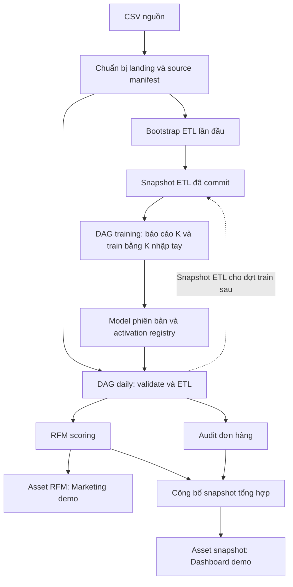
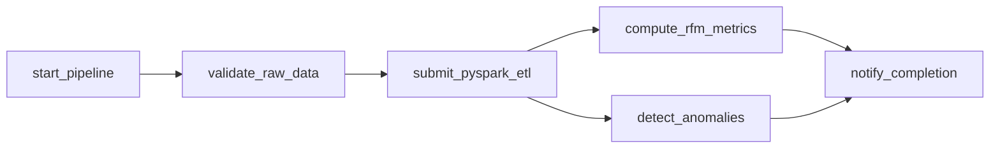
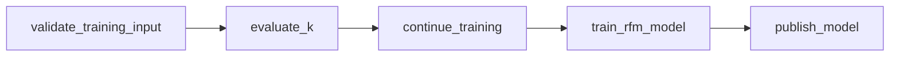
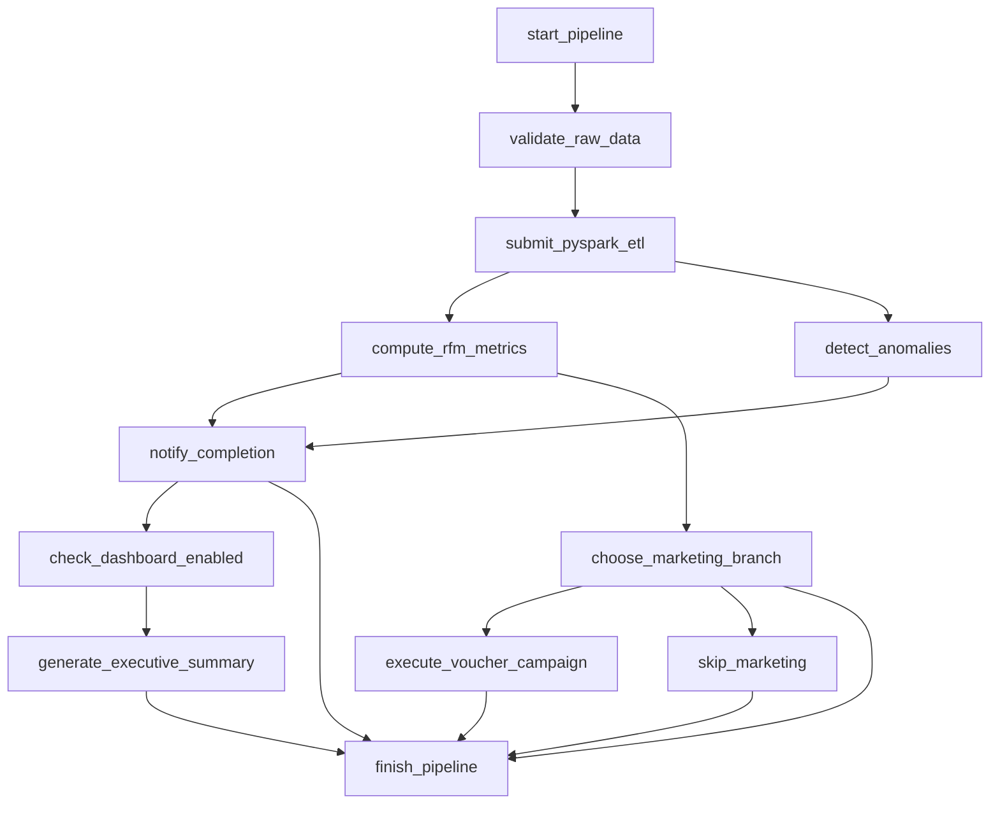

# Kiến trúc project và cấu hình các DAG

Cập nhật theo mã nguồn ngày 15/10/2026, bao gồm task đánh giá K mới trong DAG training. Tài liệu mô tả cấu hình được khai báo trong repository; không khẳng định các container, pool hoặc DAG đang hoạt động trên máy. Phần tích hợp K mới chưa được kiểm thử chạy Airflow/Spark vì Docker chưa hoạt động tại lần kiểm tra gần nhất.

## 1. Hệ thống được xây dựng để làm gì?

Project xử lý dữ liệu giao dịch Online Retail theo ba nghiệp vụ: làm sạch giao dịch, phân tích/phân cụm khách hàng RFM, và kiểm tra bất thường đơn hàng. Airflow điều phối công việc; Spark thực hiện tính toán; Parquet lưu dữ liệu kết quả; JSON manifest ghi nhận nguồn gốc và trạng thái hợp lệ của mỗi lần chạy.

Training model được tách khỏi scoring hằng ngày. Một phiên bản scaler/KMeans đã train được lưu lại và sử dụng cho nhiều lần scoring. Marketing và Dashboard là consumer demo kiểm tra kết quả đã công bố rồi ghi log; chưa gửi voucher/email hoặc cập nhật một hệ thống dashboard thật.

Project có **5 DAG**, nhưng có **hai cách tổ chức daily thay thế nhau**:

| DAG | Số task | Mục đích | Cách kích hoạt |
|---|---:|---|---|
| `ecommerce_etl_dag` | 6 | ETL, RFM, audit và công bố dữ liệu | Lịch ngày hoặc chạy tay/backfill |
| `retail_rfm_training_dag` | 5 | Báo cáo K, train, kiểm tra và kích hoạt model | Lịch tháng hoặc chạy tay |
| `retail_marketing_consumer_dag` | 1 | Consumer demo của kết quả RFM | Asset `rfm_customers` |
| `retail_executive_dashboard_dag` | 1 | Consumer demo của snapshot tổng hợp | Asset `retail_snapshot` |
| `ecommerce_etl_dag_allinone` | 12 | Gộp daily và hai consumer, có bật/tắt từng consumer | Lịch ngày hoặc chạy tay/backfill |

Với kiến trúc tách DAG, dùng daily + training + hai consumer. Với kiến trúc all-in-one, dùng all-in-one + training. Không cần chạy cả hai daily cho cùng dữ liệu trong một lần demo: chúng tính toán trùng, dù thư mục mỗi run riêng biệt; pointer công bố theo ngày vẫn dùng chung.

## 2. Sơ đồ tổng thể



Mũi tên giữa training/model/daily thể hiện phụ thuộc dữ liệu. Code không có `TriggerDagRunOperator` để training tự kích hoạt daily, cũng không có sensor chờ training giữa hai DAG. Daily tìm model hợp lệ trong registry; training đọc snapshot ETL đã commit.

## 3. Hạ tầng và cấu hình thực thi

Nguồn cấu hình: [docker-compose.yaml](../docker-compose.yaml), [Dockerfile](../Dockerfile), [requirements.txt](../requirements.txt).

| Thành phần | Cấu hình trong repository | Vai trò |
|---|---|---|
| Airflow | Image nền `apache/airflow:3.3.1` | Điều phối DAG, task, lịch và trạng thái |
| Executor | `LocalExecutor` | Chạy task bằng tiến trình cục bộ trong môi trường scheduler |
| PostgreSQL | `postgres:16` | Metadata Airflow, không phải kho Parquet nghiệp vụ |
| `airflow-init` | Migration DB và tạo tài khoản theo env | Khởi tạo môi trường |
| `airflow-apiserver` | Cổng host 8080 | UI/API và Execution API |
| `airflow-scheduler` | `command: scheduler` | Quyết định task đủ điều kiện chạy |
| `airflow-dag-processor` | `command: dag-processor` | Đọc và xử lý định nghĩa DAG |
| Java | OpenJDK 17 | Runtime cho Spark JVM |
| PySpark | `4.2.0` | ETL, RFM, audit, KMeans |

Các provider được pin: Spark `6.3.2`, Standard `1.17.0`, FAB `3.8.0`, OpenLineage `2.20.0`; OpenLineage Python `1.52.0`.

Compose không khai báo Spark master/worker cluster, Celery worker, Redis hay triggerer. Spark Connection `spark_default` đặt `host=local[2]`: Spark chạy local với hai luồng xử lý, không phải một cụm nhiều máy. Spark vẫn dùng API DataFrame và cơ chế chia partition của Spark.

Các thư mục được mount tương ứng vào `/opt/airflow`: `dags/`, `scripts/`, `data/`, `logs/`; `tests/` và `pyproject.toml` mount chỉ đọc. Vì vậy task đọc cùng filesystem mà người dùng thấy ở repository. `PYTHONPATH` bao gồm thư mục project, scripts và dags để import các module dùng chung.

Hai Connection được cấp qua biến môi trường:

- `spark_default`: loại Spark, master `local[2]`.
- `retail_landing`: loại filesystem, gốc `/opt/airflow/data/raw/landing`.

Pool `retail_spark` cần tạo theo [SETUP.md](SETUP.md), với **1 slot**. Mọi Spark task trong các DAG dùng 1 slot. Đây là giới hạn toàn cục giữa cả daily, all-in-one và training. `max_active_tasks=2` của daily không làm hai Spark task chạy đồng thời nếu pool chỉ có 1 slot. Lệnh `spark-submit` chạy tay bên ngoài Airflow không đi qua pool này.

Các Spark task khai báo `deploy_mode=client`, `driver_memory=3g`, timezone Spark UTC, `durable=False`, và `do_xcom_push=False`. Cấu hình bộ nhớ là cho driver; không phải trần RAM của toàn bộ container. Params, lịch, retry và giới hạn DAG nằm trong file DAG; nguồn/model/cutoff và tính hợp lệ dữ liệu được kiểm tra thêm trong các module Python.

## 4. Cách hiểu ngày dữ liệu và lịch chạy

Tất cả cron trong DAG dùng **UTC**. Mốc 00:00 UTC tương ứng 07:00 Việt Nam, nhưng đây là lịch cho dataset lịch sử 2010–2011, không phải dữ liệu thời gian thực năm 2026.

| Khái niệm | Ý nghĩa trong code | Ví dụ |
|---|---|---|
| `business_date` | Ngày nguồn daily cần xử lý | `2011-06-01` |
| `run_date` trong context daily | Cutoff loại trừ, bằng business_date + 1 ngày | `2011-06-02` |
| `training_cutoff` | Chỉ dùng giao dịch có InvoiceDate nhỏ hơn cutoff | `2011-06-01`: đến hết 31/05 |
| `effective_from` | Cutoff scoring đầu tiên được phép sử dụng model | Mặc định cutoff train + 1 ngày |
| `data_interval` | Khoảng dữ liệu lịch Airflow đại diện | Daily một ngày; training một tháng |

Daily scheduled/backfill lấy business_date từ đầu khoảng dữ liệu. Training scheduled lấy cutoff từ cuối khoảng dữ liệu tháng. Chạy tay phải nhập ngày tương ứng; code từ chối override mâu thuẫn với khoảng lịch.

`catchup=False` không tự tạo toàn bộ lịch sử bị bỏ lỡ. `is_paused_upon_creation=True` đặt DAG ở trạng thái pause khi mới tạo. Muốn chạy demo, trigger bằng ngày lịch sử hợp lệ hoặc backfill có chủ đích.

**DAG daily hiện tái tính snapshot lịch sử tích lũy** từ ngày đầu nguồn đến cutoff. Dù có các helper incremental trong `pyspark_rfm.py`, luồng DAG qua `retail_pipeline.py` hiện đọc snapshot ETL tích lũy. Không nên mô tả DAG này là chỉ cộng thêm batch mới vào state incremental.

## 5. DAG daily: ecommerce_etl_dag

Nguồn: [ecommerce_etl_dag.py](../dags/ecommerce_etl_dag.py).



| Cấu hình DAG | Giá trị |
|---|---|
| Timetable | `CronDataIntervalTimetable`, `0 0 * * *`, UTC |
| Start/end | `2010-12-01 00:00:00` / `2011-12-09 23:59:59.999999` UTC; bao gồm cả ngày cuối cho manual run |
| Run hoạt động tối đa | 1 |
| Task hoạt động tối đa | 2 |
| Timeout DagRun | 90 phút |
| Deadline | 60 phút tính từ DagRun được queue; callback ghi log |
| Retry mặc định | 1 lần; chờ 5 phút; exponential backoff; chờ tối đa 15 phút |
| Owner | `retail-data-team` |

Deadline là cảnh báo riêng với timeout, không phải thời gian tối đa cho từng task. Callback failure/retry/deadline hiện ghi log, chưa có kênh thông báo bên ngoài.

| Task | Operator | Công việc | Timeout cấu hình |
|---|---|---|---|
| `start_pipeline` | `EmptyOperator` | Điểm bắt đầu rõ ràng trên graph | 1 phút; không retry |
| `validate_raw_data` | `LandingValidationSensor` | Chờ manifest, kiểm tra landing, chốt context và model | Mỗi execute 2 phút; sensor chờ tối đa 1.800 giây |
| `submit_pyspark_etl` | `LineageSparkSubmitOperator` | Chạy `pyspark_clean.py` | 20 phút |
| `compute_rfm_metrics` | `RfmSparkSubmitOperator` | Chạy `pyspark_rfm.py`, kiểm tra và công bố nhánh RFM | 20 phút |
| `detect_anomalies` | `AuditSparkSubmitOperator` | Chạy `pyspark_anomalies.py`, kiểm tra và công bố nhánh audit | 30 phút |
| `notify_completion` | `PythonOperator` | Kiểm tra hai nhánh, công bố snapshot tổng hợp | 2 phút; `all_success` |

Sensor kế thừa `FileSensor`, chờ `<source_version>/manifest.json`. Cấu hình `mode=reschedule`, `poke_interval=60`, `soft_fail=False`, `deferrable=False`, `retries=0`. Khi chưa có file, sensor nhường worker giữa các lần kiểm tra. Đây **không phải deferrable operator**. Khi manifest có nhưng input không hợp lệ, phần validation có thể fail ngay.

Các Params:

| Param | Mặc định | Vai trò |
|---|---|---|
| `business_date` | null | Bắt buộc khi trigger tay |
| `source_version` | `online-retail-v1` | Phiên bản landing |
| `rfm_k` | null | Nếu nhập thì kiểm tra phải khớp K của model; không train lại |
| `model_version` | null | Chọn model hợp lệ theo cutoff, hoặc pin một version |
| `churn_days` | 90 | Ngưỡng phục vụ phân loại trạng thái khách hàng |

ETL tạo các tập `transactions`, `audit_input`, `parse_errors`. Tập dùng cho RFM có yêu cầu dữ liệu khác audit: audit cần giữ các tình huống có thể là bằng chứng bất thường. Hai nhánh cùng dùng ETL nhưng không buộc dùng cùng một tập bản ghi đã lọc.

RFM tính Recency/Frequency/Monetary theo lịch sử, tạo điểm RFM, load PipelineModel đã lưu và gọi transform. K lấy từ model. Output có các thông tin phiên bản để truy vết. Điểm theo phân bố khách hiện tại vẫn có thể đổi, dù model không được train lại.

Audit tạo kết quả ở mức dòng, đơn hàng và các đơn bị gắn cờ. Đây là phân tích bất thường hồi cứu theo rule, không phải xác nhận gian lận.

Sau Spark, hai custom operator kiểm tra stage manifest và marker đầu ra **bên trong execute** trước khi task được coi là thành công và phát Asset. Việc công bố không chỉ dựa vào callback thành công.

## 6. DAG training: retail_rfm_training_dag

Nguồn: [retail_rfm_training_dag.py](../dags/retail_rfm_training_dag.py).



| Cấu hình | Giá trị |
|---|---|
| Timetable | `0 0 1 * *`, UTC, khoảng dữ liệu tháng |
| Start/end | `2010-12-01 00:00:00` / `2011-11-01 23:59:59.999999` UTC; bao gồm cả ngày cuối. Manual trigger cần logical date trong khoảng này, còn training_cutoff được nhập riêng |
| Run/task hoạt động tối đa | 1 / 1 |
| Timeout DagRun | 90 phút |
| Retry mặc định | 1 lần sau 5 phút; callback ghi log |
| DeadlineAlert | Không khai báo |

| Task | Cách hoạt động |
|---|---|
| `validate_training_input` | PythonOperator; xác định ngày, kiểm tra ETL đã commit, chốt manifest/hash/seed/K vào context. Timeout 2 phút, không retry |
| `evaluate_k` | Spark chạy `select_kmeans_k.py` với context trên; xuất điểm WSSSE/silhouette. Timeout 30 phút |
| `continue_training` | ShortCircuitOperator; trả về `not report_only`. Khi false, skip train và publish. Không khai báo execution_timeout riêng |
| `train_rfm_model` | Spark chạy `retail_training.py`; fit pipeline, lưu model mới, đọc lại để kiểm tra. Timeout 30 phút |
| `publish_model` | PythonOperator; kiểm tra candidate, hash, provenance rồi thêm activation vào registry. Timeout 2 phút, `all_success` |

Các Params:

| Param | Mặc định | Vai trò |
|---|---|---|
| `training_cutoff` | null | Bắt buộc khi chạy tay; loại trừ giao dịch từ ngày này |
| `effective_from` | null | Suy ra cutoff + 1 ngày; phải sau cutoff train |
| `source_version` | `online-retail-v1` | Chọn nguồn tương ứng |
| `etl_manifest` | null | Nếu không nhập, tìm index ETL theo source/cutoff; nếu nhập, pin snapshot cụ thể |
| `rfm_k` | 2 | K do người dùng chọn, từ 2 đến 20 |
| `report_only` | false | true: chỉ xuất báo cáo, không train/publish |
| `k_max` | 8 | Thử từ K=2 đến giới hạn này; giảm theo số khách có sẵn |

Seed training hiện là 42. Model pipeline gồm biến đổi đặc trưng RFM/log, scaler và KMeans theo các helper dùng chung. Kết quả gồm artifact Spark và `model.json` chứa K, seed, centers, scaler, số khách theo cụm, cutoff và các hash nguồn/code.

Báo cáo K đọc **đúng đường dẫn transactions trong ETL manifest của context training**, xác minh hash/cutoff và dùng cùng seed. Dữ liệu tích lũy trước cutoff được tính RFM rồi dùng để thử K; báo cáo không thay đổi `rfm_k`. Output ở `data/analytics/k_selection/<run_key>/`: CSV, report.json và PNG nếu môi trường có matplotlib. Requirements hiện không khai báo matplotlib nên không bảo đảm có PNG.

Quy trình chọn tay: chạy `report_only=true`, đọc báo cáo, sau đó tạo DagRun mới với `rfm_k` đã chọn và cùng `etl_manifest`/cutoff. Khi `report_only=false`, DAG tạo báo cáo rồi train ngay với K đã nhập từ đầu. Không có bước chờ duyệt giữa một DagRun. Báo cáo lỗi sẽ chặn training phía sau. Xem [K_SELECTION_VI.md](K_SELECTION_VI.md).

Training không tự tạo ETL khi thiếu snapshot và không chờ daily hoàn tất. Lần đầu cần bootstrap ETL qua `retail_training.py --bootstrap-date ... --run-id ...`; bootstrap là CLI, không phải DAG thứ sáu. Chỉ sau khi có ETL và model đầu tiên mới chạy daily scoring được.

## 7. Hai DAG consumer qua Asset

Nguồn: [retail_marketing_consumer_dag.py](../dags/retail_marketing_consumer_dag.py) và [retail_executive_dashboard_dag.py](../dags/retail_executive_dashboard_dag.py).

| Thuộc tính | Marketing | Dashboard |
|---|---|---|
| Schedule | `[RFM_CUSTOMERS_ASSET]` | `[RETAIL_SNAPSHOT_ASSET]` |
| Task | `execute_voucher_campaign` | `generate_executive_summary` |
| Callable | `run_marketing_campaign` | `build_executive_summary` |
| Owner | `marketing-team` | `executive-analytics` |
| Retry | 1 lần, chờ 2 phút | 1 lần, chờ 2 phút |
| Task timeout | 2 phút | 2 phút |
| Max active runs | 1 | 1 |

Cả hai có start_date `2010-12-01`, catchup=false, pause khi tạo mới, không khai báo cron/end_date/DagRun timeout riêng. Event metadata mang danh tính snapshot; consumer không chỉ mở pointer mới nhất của ngày vì pointer đó có thể đã đổi.

Marketing được phép chạy sau khi nhánh RFM công bố thành công, kể cả audit chưa xong hoặc về sau bị lỗi. Dashboard chỉ chạy khi snapshot tổng hợp của ETL + RFM + audit đã được xác minh và công bố. Đây là chủ đích tách mức độ sẵn sàng dữ liệu.

Trigger tay consumer không tự có metadata Asset hợp lệ; không nên coi nó giống trigger tay daily có business_date. Consumer hiện xác minh sự kiện/publication rồi ghi log, chưa thực hiện campaign hay dashboard refresh thật.

## 8. DAG all-in-one

Nguồn: [ecommerce_etl_dag_allinone.py](../dags/ecommerce_etl_dag_allinone.py).

DAG này giữ sáu task cốt lõi daily và thêm sáu task phục vụ consumer/điều kiện/kết thúc. Lịch, giới hạn run/task, deadline, timeout, retry, sensor và Spark config tương ứng daily. Params bổ sung `enable_marketing=true` và `enable_dashboard=true`.



- `choose_marketing_branch`: BranchPythonOperator chọn Marketing hoặc `skip_marketing`, timeout 1 phút.
- `check_dashboard_enabled`: ShortCircuitOperator, timeout 1 phút; `ignore_downstream_trigger_rules=False` để chỉ skip task Dashboard trực tiếp khi tắt.
- Hai consumer PythonOperator có timeout 2 phút, không push XCom.
- `finish_pipeline`: EmptyOperator với `none_failed_min_one_success`; chịu được nhánh bị skip nhưng không che lỗi upstream. Completion là dependency trực tiếp để cả hai nhánh analytics vẫn bắt buộc dù tắt consumer.

All-in-one không khai báo Asset schedule/inlets/outlets. `notify_completion(emit_assets=False)` trả metadata qua XCom cho Dashboard cùng run. Marketing dùng publication RFM cùng run. Không phát sự kiện để tự kích hoạt hai consumer DAG riêng.

Các công tắc là tham số cấu hình, chưa phải quyết định tự động dựa trên giá trị doanh thu, số anomaly hoặc quy mô khách hàng. Training vẫn nằm ngoài all-in-one.

## 9. File nào bổ trợ DAG nào?

### Lớp điều phối và publication

| File trong `dags/retail_support/` | Vai trò |
|---|---|
| `tasks.py` | Sensor tùy biến; xác định ngày; wrapper Spark nhánh; completion; validate/publish model; callback log |
| `assets.py` | Định nghĩa tên/URI logical của curated, RFM, flagged anomalies và snapshot |
| `publication.py` | Kiểm tra manifest, hash và marker; đóng băng kết quả nhánh; tạo event metadata |
| `consumer_events.py` | Đọc/kiểm tra sự kiện và snapshot; tránh dùng nhầm generation hoặc run |
| `allinone.py` | Callable bật/tắt consumer và consumer dựa trên manifest/XCom cùng run |
| `spark_lineage.py` | `LineageSparkSubmitOperator`, thêm Spark listener tùy chọn lúc execute |
| `lineage.py` | Custom OpenLineage extractor, mô tả input/output và lineage ở mức nghiệp vụ |
| `__init__.py` | Package chứa các module hỗ trợ |

### Lớp xử lý và hợp đồng dữ liệu

| File trong `scripts/` | Vai trò và nơi dùng |
|---|---|
| `prepare_daily_landing.py` | Đọc CSV nguồn, tạo landing theo ngày và source manifest; chạy trước DAG |
| `retail_contracts.py` | Kiểm tra đường dẫn/ngày/nguồn, hash, context, stage manifest và completion; dùng rộng khắp |
| `retail_pipeline.py` | Runtime chung `run_stage`: đọc context, chạy clean/RFM/audit, ghi output phiên bản và stage manifest |
| `pyspark_clean.py` | Logic làm sạch; entry point Spark cho task ETL |
| `pyspark_rfm.py` | Tính RFM, feature pipeline, scoring, validation; có CLI/helper incremental độc lập với luồng DAG |
| `pyspark_anomalies.py` | Rule bất thường và kết quả dòng/đơn; entry point task audit |
| `anomaly_summary.py` | CLI đọc kết quả anomaly và in bảng Markdown tổng hợp phục vụ tài liệu; không phải task DAG |
| `anomaly_evidence.py` | Phân tích CSV bằng pandas/numpy, in bảng bằng chứng rule phục vụ tài liệu; không phải task DAG |
| `retail_models.py` | Ràng buộc model, tìm model theo cutoff, pin ETL training, kiểm tra artifact và activation registry |
| `retail_training.py` | Runtime train model có version và CLI bootstrap ETL |
| `select_kmeans_k.py` | Thử dải K và xuất báo cáo; nhận context training hoặc input/cutoff CLI |
| `train_rfm_kmeans.py` | Helper fit pipeline và CLI training riêng; không phải application trực tiếp của task train trong DAG |
| `retail_spark_lineage.py` | Cấu hình listener, kiểm tra/tải JAR và transport cho lineage Spark tùy chọn |

Các entry point `pyspark_*.py` nhận `--pipeline-context` sẽ đi vào runtime chung tương ứng. Vì vậy muốn hiểu hành vi thực tế của DAG phải đọc cả script entry point lẫn `retail_pipeline.py`, không chỉ các tham số CLI cũ.

### Cấu hình, tài liệu và kiểm thử

| File/thư mục | Vai trò |
|---|---|
| `Dockerfile`, `requirements.txt` | Xây image, pin runtime và provider |
| `docker-compose.yaml` | Các service, Connection, volume, executor và env mặc định |
| `.env.example` / `.env` | Mẫu cấu hình và giá trị local; không phải nơi định nghĩa graph DAG |
| `docker-compose.lineage.yaml` | Override tùy chọn thêm Marquez và transport HTTP |
| `pyproject.toml`, `requirements-dev.txt` | Cấu hình/công cụ phát triển và kiểm tra |
| `tests/test_retail_dag.py`, `test_allinone_dag.py` | Topology, operator, ngày, Params, branch/gate |
| `tests/test_retail_contracts.py`, `test_retail_models.py` | Hợp đồng nguồn/context/model và điều kiện hiệu lực |
| `tests/test_retail_pipeline.py`, `test_retail_training.py` | Luồng Spark, persistence, training/scoring |
| `tests/test_pyspark_*.py` | Logic xử lý dữ liệu và kiểm tra đầu ra |
| `tests/test_k_selection_context.py` | K report dùng đúng snapshot, cutoff, seed; từ chối context sai |
| `tests/test_*publication.py`, `test_consumer_events.py` | Công bố nhánh/tổng hợp, identity và event |
| `tests/test_retail_lineage.py`, `test_spark_lineage.py` và smoke scripts | Lineage và transport |
| `docs/` | Setup, nghiệp vụ, kiến trúc và bằng chứng các lần chạy |
| `.agent/` | Ghi nhận công việc/quyết định của contributor; không thuộc runtime DAG |

## 10. Dữ liệu, context, manifest và XCom phối hợp thế nào?

**Context** là đầu vào đã chốt của một DagRun. **Stage manifest** ghi kết quả của một bước. **Publication** xác nhận kết quả đủ điều kiện cho consumer. **Registry** ghi các model activation. Chúng là JSON metadata, không chứa toàn bộ giao dịch.

```text
data/
  raw/data.csv
  raw/landing/<source_version>/... và manifest.json
  manifests/runs/<run_key>/
    context.json
    etl.json, rfm.json, audit.json          # tùy loại run
    completion.json                      # daily hoàn tất
    training.json                        # candidate của training
  manifests/etl/<source_version>/<cutoff>.json
  manifests/models/registry.json
  manifests/published/<cutoff>.json
  curated/run_date=<cutoff>/version=<id>/...
  analytics/rfm_daily/run_date=<cutoff>/version=<id>/...
  audit/anomalies/run_date=<cutoff>/version=<id>/...
  models/rfm/version=<id>/pipeline/ và model.json
  analytics/k_selection/<run_key>/...
```

`run_key` được tạo từ danh tính DAG/run. XCom chủ yếu truyền `context_path` và metadata nhỏ. Spark nhận đường dẫn qua Jinja `ti.xcom_pull(...)`, sau đó đọc context và dữ liệu trên volume. DataFrame/Parquet không được đẩy qua XCom.

Output versioned giúp mỗi generation có đường dẫn riêng. Stage được công bố sau khi ghi thành công; validation đọc `_SUCCESS`, manifest/hash và danh tính nguồn. Pointer theo ngày là chỗ tra cứu thuận tiện nhưng có thể đổi; sự kiện consumer giữ đường dẫn run-specific và hash để đọc đúng snapshot đã được thông báo.

Retry một nhánh đã công bố sẽ tái sử dụng snapshot đã đóng băng thay vì tự quảng bá generation khác. Đổi input/model/business code có thể yêu cầu DagRun mới. Model artifact được kiểm tra hash; activation ghi dưới lock và thay registry JSON theo cách atomic. Không diễn giải cơ chế này thành giao dịch ACID cho toàn bộ filesystem: tính nhất quán được thực hiện qua kiểm tra và quy tắc publication của project.

## 11. Asset và OpenLineage khác nhau ra sao trong project?

| Cơ chế | Vai trò |
|---|---|
| Task dependency `>>` | Điều phối thứ tự trong một DAG |
| Asset event | Báo dữ liệu sẵn sàng và lên lịch consumer DAG |
| OpenLineage | Ghi nhận job/run/input/output để truy vết |
| Manifest/hash/marker | Kiểm chứng kết quả thực tế và danh tính snapshot |

Trong daily tách DAG, RFM task phát `rfm_customers`; audit task phát `flagged_anomalies`. Completion phát `curated_transactions` và `retail_snapshot`. Hai consumer hiện chỉ dùng `rfm_customers` và `retail_snapshot`; không có DAG consumer riêng cho flagged anomalies.

Các URI Asset là tên logic. Đường dẫn Parquet generation thực nằm trong metadata/manifest. Thay đổi file trên đĩa không tự phát Asset event; việc phát event gắn với task thành công có outlet.

Compose mặc định bật OpenLineage nếu không override `OPENLINEAGE_DISABLED`, dùng namespace `retail-local`, custom extractor và transport file dưới logs/openlineage. Spark JVM listener mặc định tắt qua `RETAIL_SPARK_LINEAGE_ENABLED=false`; khi bật, wrapper kiểm tra Spark/JAR và gắn listener ngay trước submission. Tùy chọn Marquez bổ sung API cổng 5000, UI 3000 và PostgreSQL riêng qua Compose override. Lineage không thay thế validation/publication và không tự quyết định lịch Asset.

## 12. Trình tự vận hành một lần demo

1. Tạo cấu hình local theo SETUP, build image, init DB và bật các service.
2. Chuẩn bị CSV/landing; tạo pool `retail_spark` một slot; kiểm tra DAG import.
3. Bootstrap ETL ở cutoff train đầu tiên. Ví dụ business date bootstrap `2011-11-30` tạo snapshot cutoff `2011-12-01`.
4. Chạy training `report_only=true`, cutoff `2011-12-01`; xem báo cáo K.
5. Chạy training mới với cùng ETL/cutoff và K đã chọn, report_only=false. Model có effective_from mặc định `2011-12-02`.
6. Chạy **một** daily variant, ví dụ business_date `2011-12-09`, cutoff scoring `2011-12-10`.
7. Với daily tách DAG, bật hai consumer để nhận Asset events; với all-in-one, chọn enable_marketing/enable_dashboard.
8. Kiểm tra task logs, publication manifest và đường dẫn output generation. Xem lineage nếu đã cấu hình.

Điều kiện model scoring: training_cutoff phải nhỏ hơn cutoff scoring; effective_from không vượt cutoff scoring; nguồn và hash phải tương thích. K nhập ở daily chỉ là kiểm tra tương thích với model. Nếu không có model hợp lệ, daily fail rõ ràng; không tự train dự phòng.

## 13. Phạm vi đã có và các giới hạn hiện tại

- Có phân lớp orchestration / computation / metadata contracts / consumers / observability.
- Có hai lựa chọn điều phối consumer: Asset-driven và task dependency trong all-in-one.
- Có versioning model/output, chốt input theo run, kiểm tra hash và publication theo nhánh.
- K vẫn do người dùng lựa chọn; mặc định training là 2, không tự kế thừa K của model đang phục vụ.
- Hai nhánh analytics độc lập trên graph nhưng cấu hình pool đề xuất chỉ cho một Spark JVM chạy tại một thời điểm.
- Không dùng deferrable operators và không có triggerer service trong Compose hiện tại.
- Lịch và effective dates phục vụ demo dữ liệu lịch sử; không tự chuyển thành pipeline dữ liệu hôm nay.
- Marketing/Dashboard mới là điểm tích hợp demo. Nhãn Cluster của KMeans không mặc định có ý nghĩa nghiệp vụ cố định qua các model version.
- Phần K vừa bổ sung đã qua hai test context và kiểm tra cú pháp, chưa xác nhận chạy đầy đủ DAG/Spark. Bằng chứng các lần chạy cũ không bao phủ thay đổi này.

Đọc tiếp: [SETUP.md](SETUP.md), [K_SELECTION_VI.md](K_SELECTION_VI.md), [ALLINONE_DAG_VI.md](ALLINONE_DAG_VI.md), [OPENLINEAGE_VI.md](OPENLINEAGE_VI.md), [SPARK_OPENLINEAGE_VI.md](SPARK_OPENLINEAGE_VI.md).
